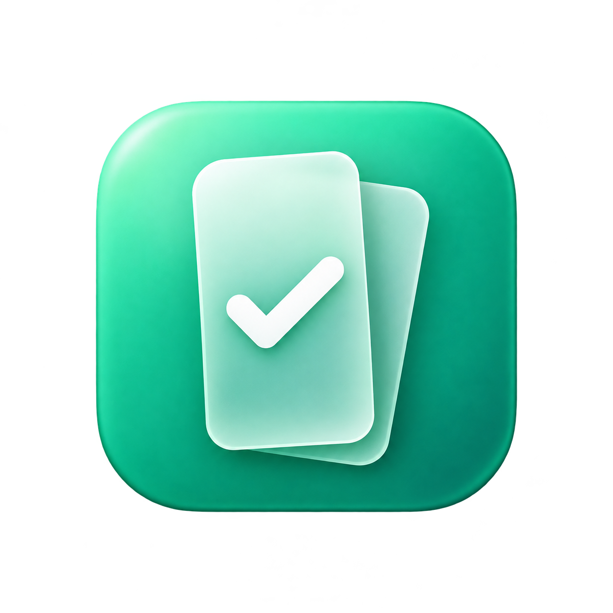

# Float Tasks

A small native macOS menu-bar app for managing Google Tasks in a translucent, vertical floating panel.

The panel starts at 280 points wide and can shrink to 240. Each list has its own collapsible card, so your tasks fit beside the work you are doing.

## Features

- Vertically stacked lists with active tasks and a collapsible Completed section.
- Quick-add, title and notes editing, date-only due dates, complete/reopen, and confirmed deletion inside the app.
- A transparent window with rounded material cards and adjustable opacity.
- Menu-bar click to show or hide; Escape, the close button, or an outside click to dismiss.
- Pinning to keep the panel open, a draggable header, and remembered window settings.
- Local search across visible list names, task titles, and notes.
- Direct Google Tasks API access, with a refresh check every 60 seconds while running.
- A local snapshot for offline viewing and macOS Keychain storage for sign-in credentials.

Click a task to edit it, use its circle to complete or reopen it, and use **Add task** at the top of its list. Task actions stay in the native panel. This is a focused editor for task content and completion; recurring schedules, reminders, ordering, and list management are outside its current scope.

## Build and run

The app targets macOS 13 or newer. Building requires Xcode Command Line Tools with Swift 6 and a macOS SDK; the toolchain itself may require a newer macOS version. Install the tools with `xcode-select --install` if they are missing.

```sh
git clone https://github.com/iuhachicha/google-tasks-mac-desktop-floating-app.git
cd google-tasks-mac-desktop-floating-app
./build.sh
open "dist/Float Tasks.app"
```

The script builds for the current Mac’s architecture; set `TARGET_ARCH=arm64` or `TARGET_ARCH=x86_64` to choose another supported target. It uses Apple’s frameworks without third-party package dependencies. The resulting app is an **ad-hoc signed developer build**, not an Apple-notarized release.

The app starts in the menu bar without a Dock icon or an automatically opened panel. Click the checklist icon to show it. You can move the built app to Applications in Finder.

## Connect your Google account

Each user supplies their own Google Cloud project and **Desktop app** OAuth client JSON. No shared OAuth client, account, or task data is included in this repository.

1. Follow [Google setup](docs/GOOGLE_SETUP.md) to enable the Tasks API and create your client.
2. Right-click the menu-bar icon and open **Settings…**.
3. Choose **Import Google client JSON…**, then **Sign in with Google**.
4. Complete Google’s consent flow in your default browser.

Import the file locally; never add it to Git, an issue, or a pull request. New sign-ins request Google's `tasks` permission so the app can save changes. Existing read-only sign-ins keep working for viewing; choose **Enable editing** once to authorize writes. Google grants this permission across your Tasks account, not just one list. The app checks that each write targets a currently visible list.

Configuration, tokens, and granted scopes are saved in Keychain and restored when reopened, subject to Google’s token validity rules. External projects left in **Testing** normally require authorization again after seven days; the [setup guide](docs/GOOGLE_SETUP.md#testing-production-and-sign-in-lifetime) explains this limitation.

## Using the panel

| Action | How |
| --- | --- |
| Show or hide | Click the checklist menu-bar icon |
| Move | Drag the panel header |
| Resize | Drag an edge, or select a width in Settings |
| Collapse a list | Click its title; the choice is remembered |
| Add a task | Add task, enter a title, then Add |
| Edit a task | Click its title, change its title/notes/due date, then Save |
| Complete or reopen | Click the circle beside the task; expand Completed to find finished tasks |
| Delete a task | Open its editor, click the trash icon, then confirm Delete |
| Search or refresh | Use the bottom toolbar |
| Keep open | Enable the pin button |
| Close Settings | Done, Escape, the window close button, or Command-W |
| Quit | Right-click the menu-bar icon and choose Quit |

The connection indicator distinguishes a live connection from an offline or saved view. The app must remain running to refresh; it does not install a background service.

Edits are sent directly to Google, with one write at a time. Failed saves keep your draft. There is no offline write queue or automatic write retry: if a connection failure leaves the result uncertain, refresh before trying again to avoid a duplicate change. Deleting an assigned task also removes its original task in Google Docs or Chat, as stated in the confirmation.

Google's Tasks API does not expose the website's list-visibility checkboxes. The app shows all lists by default and supports a saved local selection by list ID; see [local list selection](docs/ARCHITECTURE.md#local-list-selection). This selection affects the panel, search, remaining-task counts, and permitted write targets, and remains saved across restarts. The API cache still contains all fetched lists and their active and completed tasks.

## Development

```sh
./tests/run.sh
```

See [Architecture](docs/ARCHITECTURE.md) for the source layout and data flow, [Privacy](docs/PRIVACY.md) for storage and deletion details, and [Contributing](CONTRIBUTING.md) before opening a pull request.

## License

[MIT](LICENSE). Float Tasks is an independent project, not affiliated with or endorsed by Google.
