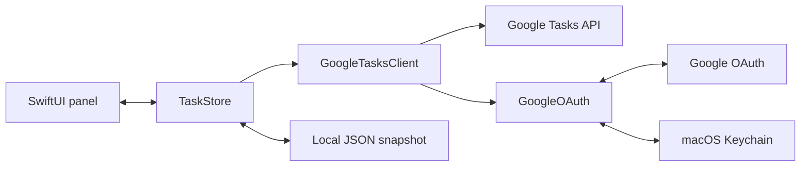

# Architecture

Float Tasks is a single native macOS process written in Swift. AppKit owns the menu-bar item and windows; SwiftUI renders the cards and settings. There is no web app, browser extension, package dependency, or hosted backend.

## Source map

| File | Responsibility |
| --- | --- |
| `Sources/App.swift` | App lifecycle, menu-bar toggle, transparent `NSPanel`, settings window, dismissal, and window preferences. |
| `Sources/FloatingUI.swift` | List cards, search, inline task editors and deletion confirmation, completed tasks, connection state, toolbar, and header dragging. |
| `Sources/Store.swift` | Observable UI state, local filtering, refresh scheduling, authorization, serialized mutations, and cache coordination. |
| `Sources/GoogleOAuth.swift` | Desktop client import, browser authorization, PKCE/state, loopback callback, token refresh, and Keychain storage. |
| `Sources/GoogleTasksClient.swift` | Tasks API reads and mutations, pagination, response validation, and date-only due conversion. |
| `Sources/Models.swift` | Codable task models, snapshot validation, and local cache paths. |

## Refresh and persistence

At startup, `TaskStore` loads a valid cached snapshot if one exists. `GoogleOAuth` restores configuration and tokens from Keychain. A 60-second timer checks whether a refresh is needed; opening the panel can also refresh when the last successful sync is older than 45 seconds or the connection is not live.

The client loads all pages of task lists and each list's active and completed tasks, including hidden completed records but excluding deleted records. A successful fetch is validated and saved atomically before replacing the visible state. Network failures retain the last saved tasks and mark the view offline. Only one refresh runs at a time. Cancellation and generation checks prevent an old refresh from restoring data after disconnect or overwriting a subsequent mutation.

New authorization clears the previous snapshot before opening the browser and aborts if that cache cannot be deleted. Changing the Desktop client clears the previous view as well. Account changes invalidate outstanding refreshes, preventing late responses from restoring another account’s tasks. The editing-permission upgrade preserves selected list IDs but still clears task content before authorization.

## Native task mutations

Quick-add, title/notes/date editing, complete/reopen, and confirmed deletion call asynchronous Store methods that return success or failure. The UI clears an add or edit draft only on success and disables duplicate actions while a write is running. Ordinary task actions never open the browser.

The Store requires write permission, a visible list, and valid list/task membership before issuing a write. It serializes mutations, invalidates stale refreshes, and reconciles successful responses into the full task collection and local cache. The API client uses POST for insertion, PATCH for the fields being changed, and DELETE for deletion. Due values represent a calendar day, with no reminder time; the editor preserves that day rather than shifting a midnight UTC timestamp into another local date.

There is no offline queue or automatic mutation retry. A network failure or unusable response after dispatch can leave the remote result unknown; users must refresh before retrying. Once a write has succeeded, a later read or cache failure must not turn it into a failed write that invites a duplicate insertion.

## Local list selection

`TaskStore` keeps complete API results in `lists` and exposes the selected subset through `visibleLists`. Search, panel cards, remaining-task counts, and permitted mutation targets use this subset. `applySelectedListIDs(_:)` saves an explicit whitelist in the `FloatTasks.selectedListIDs` macOS preference. An absent preference shows all lists; an empty array shows none. Selection uses IDs so a list rename preserves visibility and newly created lists stay hidden when a whitelist exists. There is currently no list-selection editor in Settings.

The selection survives refreshes and restarts. Disconnecting, starting an ordinary new interactive sign-in, or importing a different Desktop client resets it to avoid carrying one account's IDs into another account. Reimporting the same client and explicitly upgrading editing permission preserve the selection. The API and offline snapshot still include all lists; the local selection does not read or change the website's visibility settings and does not restrict Google's account-wide OAuth permission.

## Authentication boundary

The authorization request opens in the system browser. PKCE binds the token exchange to that attempt, and random state binds the callback to the original request. The callback listener is bound to `127.0.0.1` on an available port, validates the request, and shuts down after success, cancellation, or timeout.

Tokens and granted scopes are kept in memory and Keychain. Legacy read-only tokens remain valid for reads, while mutations require the `tasks` grant returned by an explicit authorization. New sign-ins request that write scope. Network clients reject redirects rather than forwarding authorization credentials to another endpoint.

## Building and checking changes

Run `./build.sh` from the repository root to create `dist/Float Tasks.app`, then `./tests/run.sh` for the repository checks. The build targets the current Mac’s architecture with a macOS 13 deployment target. It uses a configured certificate identity, or warns and signs ad-hoc when no identity is configured. See [Local signing](SIGNING.md).

`CODE_SIGN_IDENTITY` takes precedence over the ignored `.codesign-identity` file; both accept only a full certificate SHA-1 fingerprint. The file is read as data, never sourced. Certificate configuration is checked before compiling, and the staged bundle must pass signing and strict signature verification before replacing the previous build. Missing identities and signing failures never fall back to ad-hoc signing. An unconfigured build refuses to overwrite an existing certificate-signed bundle. `codesign` generates the normal designated requirement from the signing identity and bundle identifier; the script does not weaken it with a custom requirement.

Keychain also checks a partition identifier. Recognized Apple-issued developer identities use a team-based partition; self-signed code can fall back to a build-specific code hash even when its designated requirement is unchanged. The builder accepts self-signed identities for generic local builds, but they are not a reliable fix for repeated Keychain prompts. See the explanation and Apple source linked in [Local signing](SIGNING.md).

UI changes should also be checked manually at 240-point width, in light and dark appearance, and with empty, live, and offline states. Use synthetic task fixtures for tests and screenshots. Do not check in real snapshots, client configuration, tokens, or build products.
