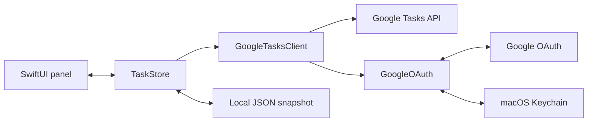

# Architecture

Float Tasks is a single native macOS process written in Swift. AppKit owns the menu-bar item and windows; SwiftUI renders the cards and settings. There is no web app, browser extension, package dependency, or hosted backend.

## Source map

| File | Responsibility |
| --- | --- |
| `Sources/App.swift` | App lifecycle, menu-bar toggle, transparent `NSPanel`, settings window, dismissal, and window preferences. |
| `Sources/FloatingUI.swift` | List cards, search, task rows, connection state, toolbar, and header dragging. |
| `Sources/Store.swift` | Observable UI state, local filtering, refresh scheduling, connection actions, and cache coordination. |
| `Sources/GoogleOAuth.swift` | Desktop client import, browser authorization, PKCE/state, loopback callback, token refresh, and Keychain storage. |
| `Sources/GoogleTasksClient.swift` | Read-only Tasks API requests, pagination, response validation, and active-task filtering. |
| `Sources/Models.swift` | Codable task models, snapshot validation, and local cache paths. |

## Refresh and persistence

At startup, `TaskStore` loads a valid cached snapshot if one exists. `GoogleOAuth` restores configuration and tokens from Keychain. A 60-second timer checks whether a refresh is needed; opening the panel can also refresh when the last successful sync is older than 45 seconds or the connection is not live.

The client loads all pages of task lists and each list’s active tasks. A successful fetch is validated and saved atomically before replacing the visible state. Network failures retain the last saved tasks and mark the view offline. Only one refresh runs at a time. Cancellation and generation checks prevent an old refresh from restoring data after disconnect.

New authorization clears the previous snapshot before opening the browser and aborts if that cache cannot be deleted. Changing the Desktop client clears the previous view as well. Account changes invalidate outstanding refreshes, preventing late responses from restoring another account’s tasks.

## Authentication boundary

The authorization request opens in the system browser. PKCE binds the token exchange to that attempt, and random state binds the callback to the original request. The callback listener is bound to `127.0.0.1` on an available port, validates the request, and shuts down after success, cancellation, or timeout.

Tokens are kept in memory and Keychain. Network clients reject redirects rather than forwarding authorization credentials to another endpoint. The Tasks client uses GET requests and the read-only scope.

## Building and checking changes

Run `./build.sh` from the repository root to create `dist/Float Tasks.app`, then `./tests/run.sh` for the repository checks. The build targets the current Mac’s architecture with a macOS 13 deployment target and applies an ad-hoc signature.

UI changes should also be checked manually at 240-point width, in light and dark appearance, and with empty, live, and offline states. Use synthetic task fixtures for tests and screenshots. Do not check in real snapshots, client configuration, tokens, or build products.
